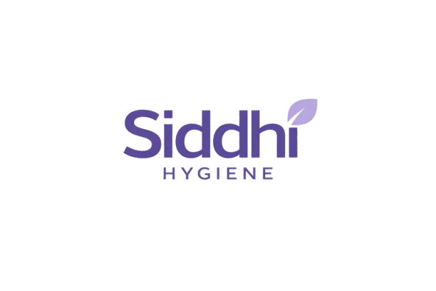
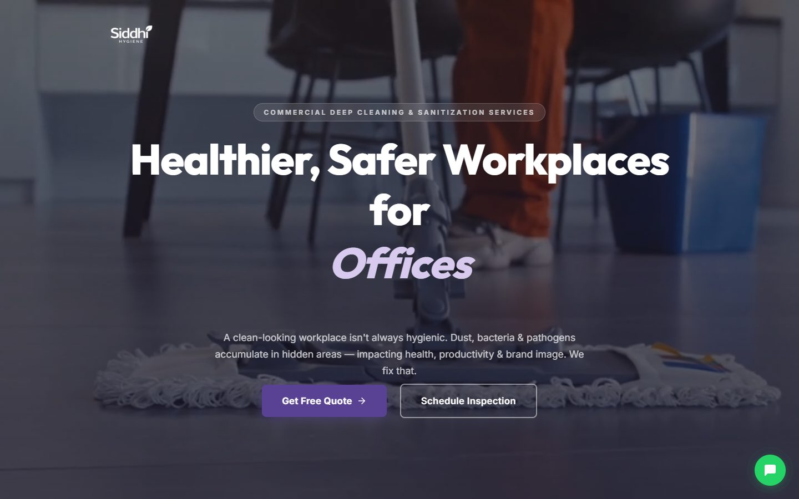
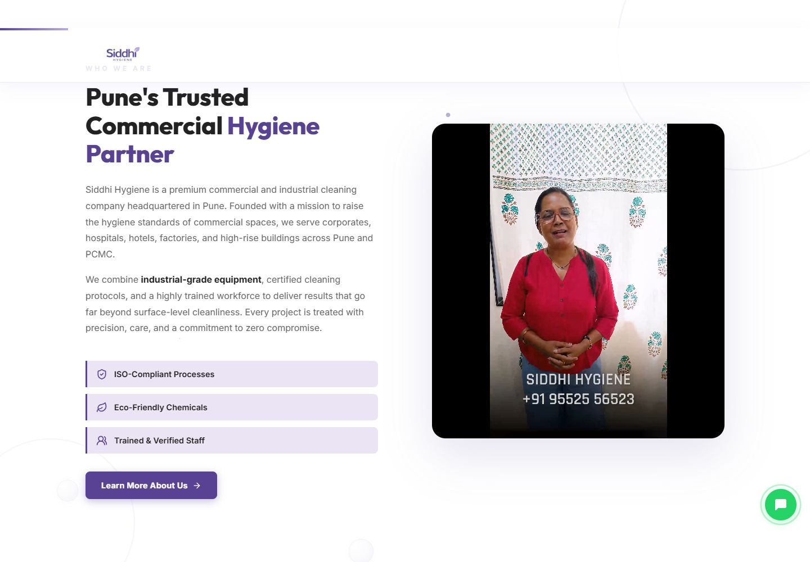
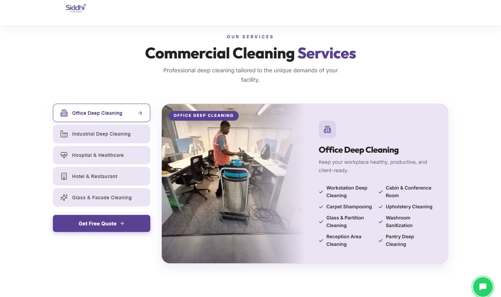
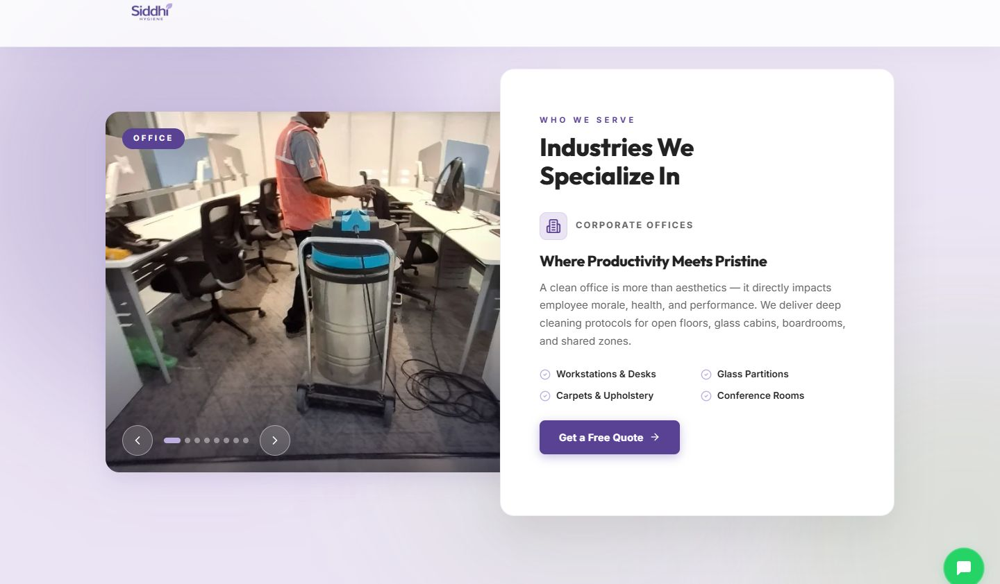
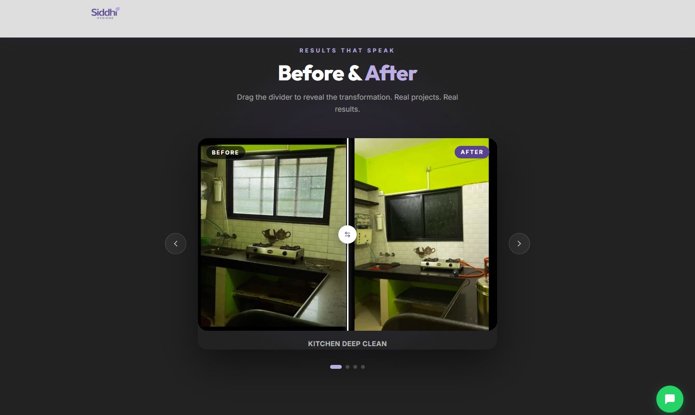
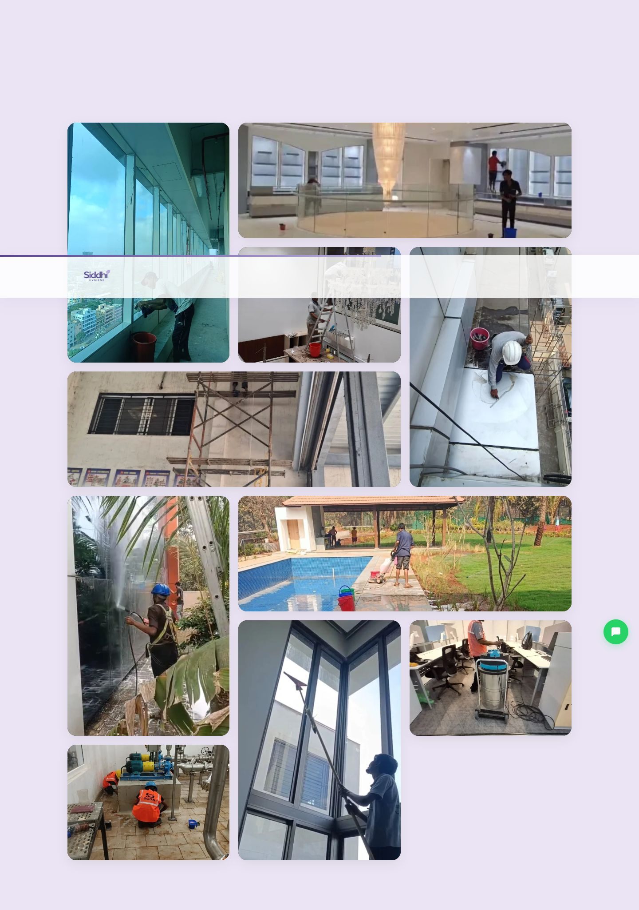
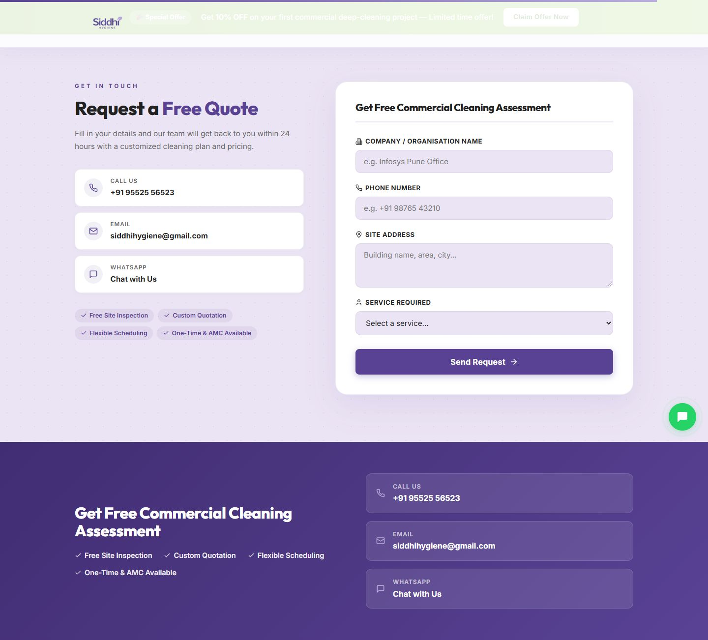
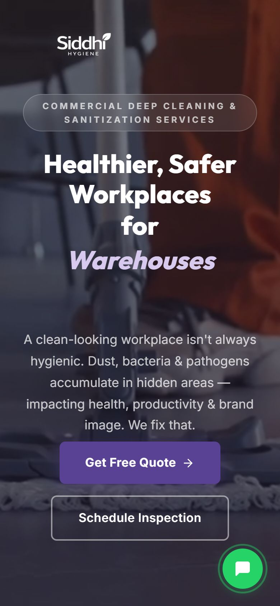

<div align="center">



# Siddhi Hygiene

**Website for a commercial deep cleaning and sanitization company in Pune.**

[](https://siddhihygiene.in)


</div>



## About

[Siddhi Hygiene](https://siddhihygiene.in) provides industrial-grade deep cleaning for corporate offices, factories, hospitals, hotels, warehouses and high-rise buildings across Pune, PCMC, Hinjewadi, Chakan and the MIDC zones.

This repository holds the company's marketing site. It is a single-page React app that presents the company's services, shows its work and client list, and takes quote requests.

## Screenshots

| About | Services |
| :---: | :---: |
|  |  |
| **Industries** | **Before & After** |
|  |  |
| **Our Work** | **Request a Quote** |
|  |  |

<p align="center">
  
  <br /><em>Mobile view</em>
</p>

## Features

- **Video hero** with a rotating headline (Offices, Industries, Hospitals, Hotels, Warehouses) and a parallax background
- **About section** with an embedded company video
- **Animated stats counters** that start when scrolled into view
- **Problems → Solutions** cards that flip on hover
- **Industries and Services** tabbed explorers with the scope of work for each sector
- **Work gallery** of real on-site projects
- **Before/after slider** that you drag to compare photos
- **Client ticker** that scrolls the list of organizations served
- **Quote form** posted through [FormSubmit](https://formsubmit.co) (no backend needed), plus call, email and WhatsApp shortcuts
- Responsive layout and SEO meta tags for local search

## Tech stack

| Layer | Tools |
| --- | --- |
| UI | React 19, CSS Modules |
| Animation | Framer Motion |
| Icons | Lucide React |
| Build | Vite 8 |
| Lint | ESLint 10 (react-hooks, react-refresh) |
| Forms | FormSubmit |
| Hosting | Apache shared hosting (`.htaccess` SPA rewrite) |

## Project structure

```
├── public/
│   ├── gallery/          # project and before/after photos
│   ├── video/            # hero-bg.mp4, about-us.mp4
│   ├── logo.png
│   └── .htaccess         # SPA fallback and video MIME types for Apache
├── src/
│   ├── components/
│   │   ├── Navbar/  Hero/  About/  Stats/  Problems/
│   │   ├── Industries/  WhySiddhi/  Services/  Gallery/
│   │   ├── BeforeAfter/  ServiceArea/  Testimonials/
│   │   ├── AMC/  Process/  Contact/  Footer/
│   ├── App.jsx
│   ├── main.jsx
│   └── index.css         # design tokens and global styles
├── docs/screenshots/     # README images
├── index.html
└── vite.config.js        # base: './' so the build works from any folder
```

## Getting started

Requires Node.js 18 or later.

```bash
git clone https://github.com/Abhxym/siddhi-hygiene.git
cd siddhi-hygiene
npm install
npm run dev
```

| Script | Description |
| --- | --- |
| `npm run dev` | Start the dev server with hot reload |
| `npm run build` | Build for production into `dist/` |
| `npm run preview` | Serve the production build locally |
| `npm run lint` | Run ESLint |

## Deployment

The live site at **[siddhihygiene.in](https://siddhihygiene.in)** runs on Apache shared hosting.

1. `npm run build`
2. Upload everything inside `dist/` to the web root (`public_html/`). This includes `.htaccess`, which is copied over from `public/`.

Asset paths are relative (`base: './'`), so the build also works from a subfolder.

## Contact

- 🌐 [siddhihygiene.in](https://siddhihygiene.in)
- 📞 +91 95525 56523
- ✉️ siddhihygiene@gmail.com

---

<p align="center">© Siddhi Hygiene. All rights reserved.</p>
